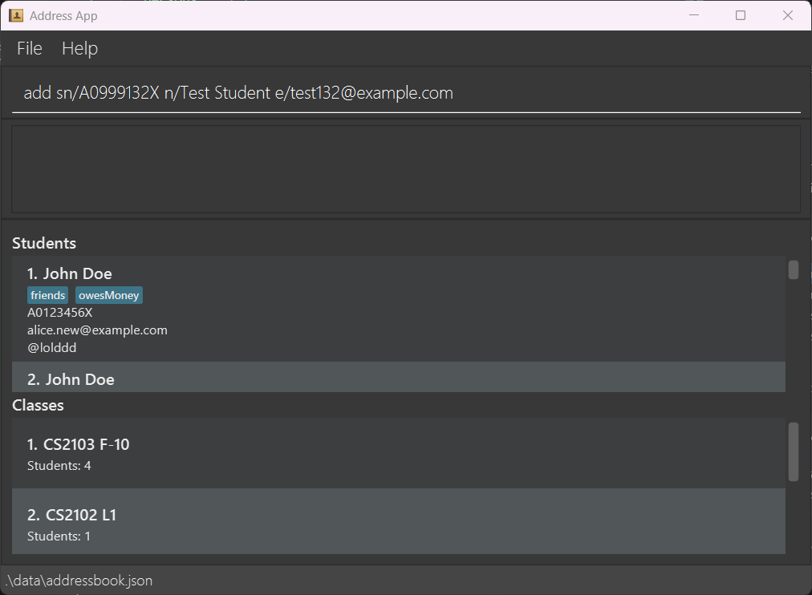
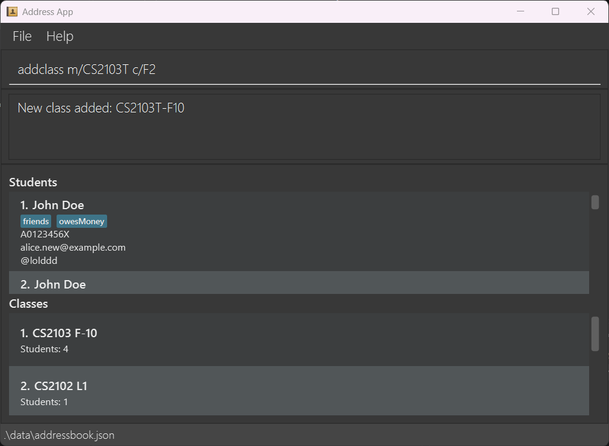
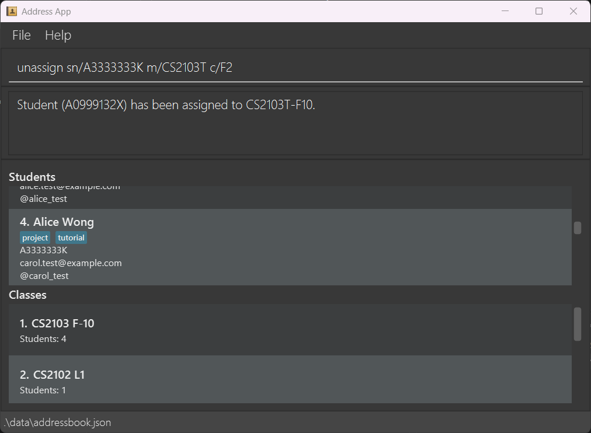
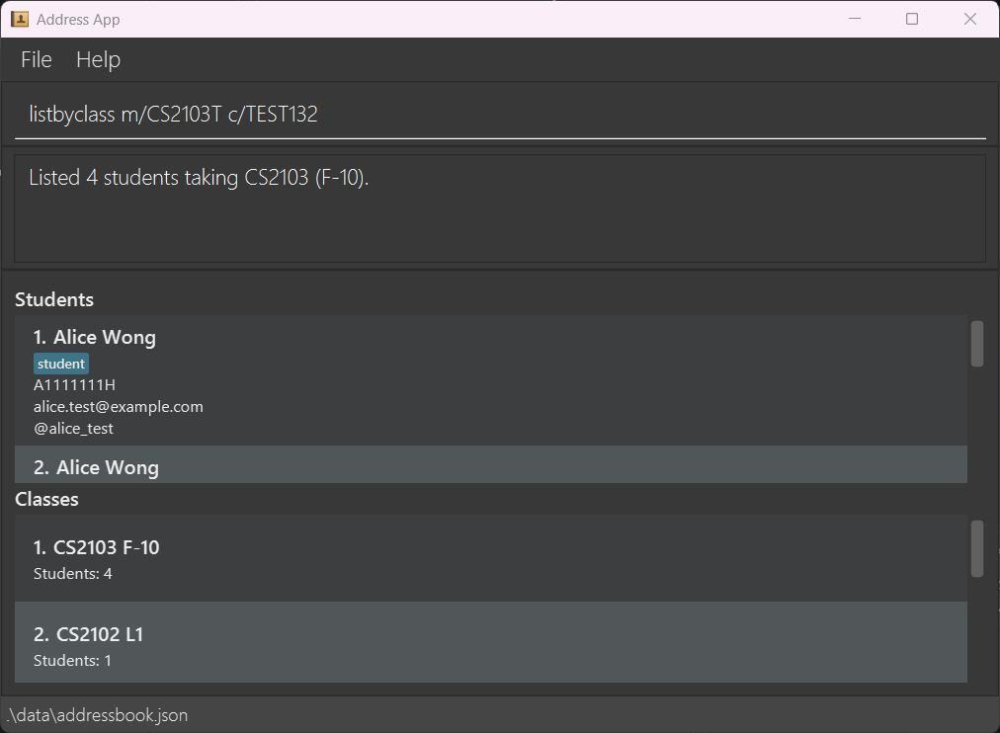

# TAssist v1.3 - MVP Release

This initial MVP release introduces the core student and class management workflows in TAssist.

## What's New
- **Migration to student details:** Replaced the address and phone number fields in `Person` with student number and optional Telegram username fields. Updated the `add` and `edit` commands, student cards and data storage to support these attributes. Added case-insensitive duplicate checks for student numbers, email addresses and Telegram usernames. ([#112](https://github.com/AY2627S1-CS2103-F10-2/tp/pull/112))

- **Class management:** Create classes using `addclass` and remove them using `deleteclass`. Each class is uniquely identified by its module code and class name. Added persistent class storage and a dedicated class panel displaying class details and student counts that update automatically when memberships change. Deleting a class preserves its students and their memberships in other classes. ([#108](https://github.com/AY2627S1-CS2103-F10-2/tp/pull/108), [#113](https://github.com/AY2627S1-CS2103-F10-2/tp/pull/113), [#125](https://github.com/AY2627S1-CS2103-F10-2/tp/pull/125), [#128](https://github.com/AY2627S1-CS2103-F10-2/tp/pull/128))

- **List all classes:** Use `listclass` to display all classes in insertion order, resetting any active class filter. The command takes no arguments and leaves the student list filter unchanged. ([#132](https://github.com/AY2627S1-CS2103-F10-2/tp/pull/132))

- **Student assignment:** Use `assign` and `unassign` to manage class memberships by student number. Students can belong to multiple classes, and these commands work even when the student is hidden by the current search filter. Memberships are saved across application restarts. ([#123](https://github.com/AY2627S1-CS2103-F10-2/tp/pull/123), [#127](https://github.com/AY2627S1-CS2103-F10-2/tp/pull/127))

- **List students in a class:** Use `listbyclass` to display a class's students alphabetically by name. Use `list` to restore the complete student list. ([#122](https://github.com/AY2627S1-CS2103-F10-2/tp/pull/122))

- **Student and class membership consistency:** Changes to student details, including student numbers, propagate to their assigned classes. Deleting a student removes their memberships from all classes. ([#127](https://github.com/AY2627S1-CS2103-F10-2/tp/pull/127))

## Miscellaneous
- **Documentation:** Updated the User Guide and Developer Guide for TAssist, including command examples, validation rules, user stories and use cases. Migrated the documentation site from Jekyll to MarkBind.

- **Help link:** Updated the Help window to link to the TAssist User Guide. ([#125](https://github.com/AY2627S1-CS2103-F10-2/tp/pull/125))

- **Testing:** Expanded automated tests for commands, parsers, models, data storage and UI components. Enabled JavaFX UI tests in Linux CI using a virtual display.

Requires **Java 25 or later**. Refer to the [User Guide](https://ay2627s1-cs2103-f10-2.github.io/tp/UserGuide.html) for setup instructions and command examples.